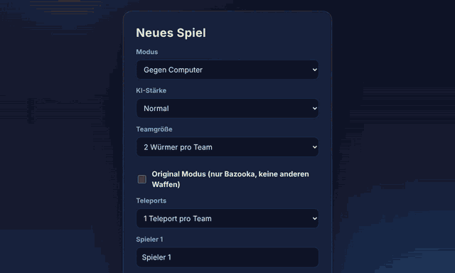
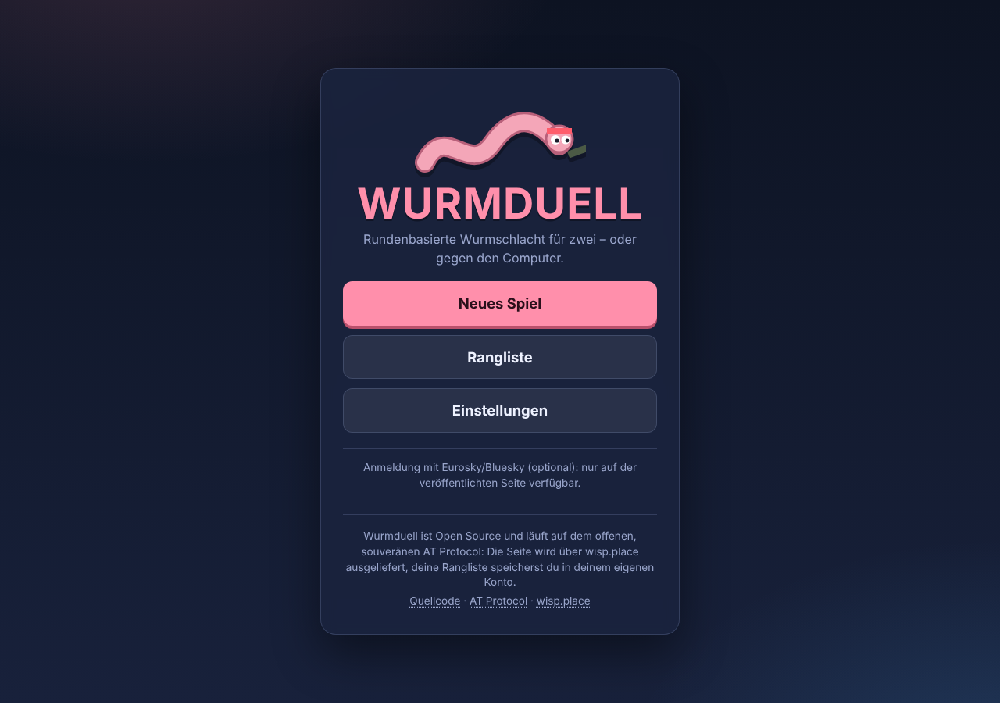
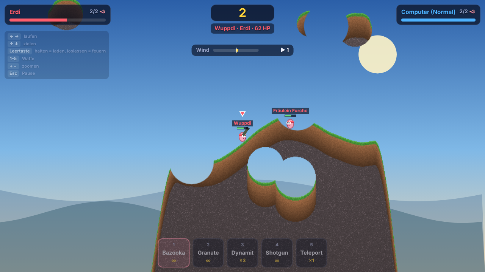
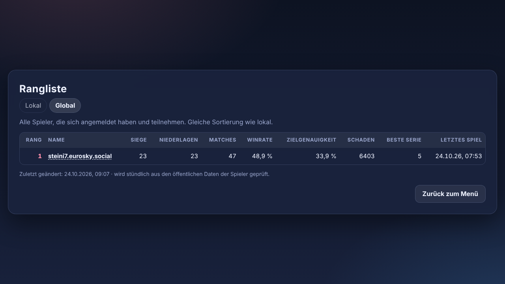

<div align="center">

# 🐛 Wurmduell

**Rundenbasierte Wurmschlacht im Browser – Open Source, ohne Server, im offenen AT Protocol.**

[](https://wurmduell.wisp.place/)

[](LICENSE)




</div>

## Worum geht's?

Zwei Teams aus 2–3 Würmern, ein zerstörbares Gelände, Wind und Wasser: Wer seine Gegner zuerst besiegt, gewinnt. Du spielst im **Hotseat** zu zweit oder gegen den **Computer** (Einfach, Normal, Schwer) – direkt im Browser, auf dem Desktop mit Tastatur.

- 💥 **Zerstörbares Gelände**, zufällig erzeugte Karten, Wind beeinflusst Schüsse
- 🚀 **Fünf Waffen:** Bazooka, Granate, Dynamit, Shotgun, Teleport (oder „Original Modus“ nur mit Bazooka)
- 🏆 **Rangliste** lokal im Browser; mit Eurosky-/Bluesky-Login zusätzlich im **eigenen PDS** und in der **globalen Rangliste**
- 🌍 Deutsch und Englisch, folgt der Browser-Sprache
- 🔓 **Open Source (MIT)**, statische Seite, gehostet auf [wisp.place](https://wisp.place) im [AT Protocol](https://atproto.com)

<table>
  <tr>
    <td align="center"><br><sub>Hauptmenü</sub></td>
    <td align="center"><br><sub>Im Spiel</sub></td>
    <td align="center"><br><sub>Globale Rangliste</sub></td>
  </tr>
</table>

## Schnellstart

```bash
git clone https://github.com/vidompteur/wurmduell.git
cd wurmduell
npm install
npm run dev   # http://localhost:5173/
```

Mehr dazu unter [Entwickeln](#entwickeln). Verlässt du eine laufende Partie, wird sie gewertet (siehe unten).

## Steuerung

| Taste | Aktion |
|---|---|
| `←` `→` oder `A` `D` | laufen |
| `↑` `↓` oder `W` `S` | Winkel einstellen |
| `Leertaste` halten | Stärke aufladen, loslassen feuert |
| `1`–`5` | Waffe wählen (Bazooka, Granate, Dynamit, Shotgun, Teleport; beim Teleport danach auf die Karte klicken) |
| Mausrad oder `+` `−` | zoomen |
| Mittel-/Rechtsklick ziehen | Kamera verschieben |
| `Esc` | Pause (Fortsetzen, Aufgeben, Zurück zum Menü; beides zählt als Niederlage) |

Verlässt du eine laufende Partie (Browser oder Tab schließen, Seite neu laden), wird sie gewertet: Es verliert das Team mit weniger Rest-Lebenspunkten, bei Gleichstand das Team, das geht. „Zurück zum Menü“ zählt immer als Niederlage.

**Original Modus:** Im Match-Setup lässt sich die Checkbox „Original Modus (nur Bazooka, keine anderen Waffen)“ aktivieren. Dann gibt es weder Granate, Dynamit, Shotgun noch Teleport; die Waffenleiste zeigt nur die Bazooka. Standard in `src/config.ts` unter `rules.pure`.

**Handys:** Beim Laden auf Touch-Geräten erscheint ein Hinweis, dass Wurmduell für den Desktop gedacht ist und eine Tastatur braucht. Mit „Verstanden“ verschwindet er nur für diesen Besuch, mit „Mir doch egal“ wird er nicht mehr angezeigt (gemerkt im Browser). Ganz abschaltbar über `hud.mobileNotice` in `src/config.ts`.

Im Spiel blendet oben links eine dezente Legende diese Tasten ein.

## Einstellungen

Unter **Einstellungen** im Hauptmenü (werden im Browser gespeichert):

- **Ansichtsgröße:** Start-Zoom, 1,0× bis 3,0×. Größer heißt größere Würmer. Gilt ab dem nächsten Spiel; im Spiel zoomst du mit Mausrad oder `+` / `−`.
- **Ton** und **Lautstärke**
- **Steuerungs-Legende im Spiel anzeigen**

## Standardwerte konfigurieren

Alle Defaults stehen zentral in [`src/config.ts`](src/config.ts):

| Bereich | Werte |
|---|---|
| `view` | Standard-Zoom (`zoomDefault`, aktuell 1,4), Zoom-Min/-Max, Reglerschritt, Zoom-Faktor pro Tastendruck, maximale Pixeldichte |
| `audio` | Ton an/aus, Lautstärke |
| `hud` | Steuerungs-Legende an/aus, Handy-Hinweis an/aus |
| `rules` | Teleports pro Team (`teleports`, Standard 1), Bazooka-Reichweite (`bazookaRange`, 1,3× Original) |
| `setup` | Vorbelegung im Match-Setup (Modus, KI-Stärke, Teamgröße, Spielernamen) |

Bereits im Browser gespeicherte Einstellungen haben Vorrang vor diesen Defaults; zum Testen den localStorage-Eintrag `wurmduell.settings.v1 löschen. Regel- und Physikkonstanten (Zugzeit, Schwerkraft, Wurmgröße, Waffenschaden) liegen in `src/game/constants.ts` bzw. `src/weapons/weapons.ts`.

## Anmeldung und Ranglisten-Sync (ATProto)

Das Spiel ist ohne Konto vollständig spielbar; die Anmeldung ist freiwillig. Wer sich im Hauptmenü mit einem ATProto-/Eurosky-Account anmeldet, bekommt seine Rangliste zusätzlich im eigenen PDS gespeichert und sieht sie auf jedem Gerät.

- **Nur auf der veröffentlichten Seite:** Die Anmeldung läuft über OAuth und braucht die öffentliche `client-metadata.json` (siehe „Eigene Instanz veröffentlichen“). Lokal mit `npm run dev` zeigt das Menü nur einen Hinweis.
- **Identität:** Spieler 1 ist dann an die DID gebunden (nicht an den Handle) und im Match-Setup gesperrt.
- **Gespeicherte Records** im PDS (Lexicons unter `lexicons/`): `de.wurmduell.ladderSummary` (ein Eintrag, `rkey: self`) und pro Partie `de.wurmduell.matchResult`.
- **Offline-sicher:** Jede Partie wird zuerst lokal gespeichert und in eine Sync-Queue gelegt. Schlägt der PDS-Zugriff fehl, bleibt sie dort und wird beim nächsten Start oder Spiel nachgeschickt. Auch Abbruch (Tab schließen) landet in der Queue.
- **Robuster Login:** Schlägt die Rückkehr vom Login fehl (z. B. „Unknown authorization session“), versucht das Spiel zuerst die gespeicherte Sitzung wiederherzustellen und startet sonst den Login einmal automatisch neu. Netzwerkfehler (Seite zeigt „Keine Verbindung“) werden von abgelaufenen Anmeldungen („Neu anmelden“ mit vorausgefülltem Handle) unterschieden und mit 5/15/45 s Abstand sowie beim Event `online` erneut versucht. Alle Schritte haben ein Zeitlimit. Die einzelnen Login-Schritte stehen als `event: auth` im Log.
- **Herkunft:** Der Browser speichert den Anmeldevorgang pro Herkunft (Domain). Öffnest du das Spiel unter einer anderen Domain als `atproto.appUrl` in `src/config.ts`, würde die Rückkehr vom Login ins Leere laufen („Unknown authorization session“). Deshalb wechselt „Anmelden“ dann zuerst auf die veröffentlichte Adresse und startet den Login dort (`?login=<handle>`).
- **Wiederholbares Schreiben:** `matchResult`-Records bekommen einen festen Schlüssel aus ihrem Inhalt (ein erneutes Schreiben legt kein Duplikat an); die Ranglisten-Zusammenfassung wird nur geschrieben, wenn sie seit dem Lesen unverändert ist, sonst wird neu gelesen und gemerged.
- **Abmelden** beendet die Session, die lokale Rangliste bleibt.
- **Scope (angefragte Rechte):** Nur `atproto` plus Anlegen/Ändern der eigenen `ladderSummary` und Anlegen von `matchResult`-Records, jeweils nur in diesen beiden `de.wurmduell.*`-Collections und ohne Löschrecht (`public/client-metadata.json`). Es gibt keinen Zugriff auf Bluesky-Posts, Follows oder Nachrichten. Falls der Login mit „invalid scope“ scheitert, ist das die erste Stelle zum Prüfen.

Code: `src/atproto/` (`auth.ts` OAuth, `Account.ts` Zustand, `sync.ts` Abgleich und Queue, `records.ts` Records und Merge-Regel).

## Logging mit Better Stack (abschaltbar)

Das Spiel kann Logzeilen an [Better Stack Logs](https://betterstack.com/docs/logs/ingesting-data/http/logs/) schicken (einfacher HTTP-POST, kein SDK). In `src/config.ts` unter `logs` den **Ingesting host** und den **Source-Token** der Quelle eintragen; ohne Host wird nichts gesendet.

Jede Zeile ist ein JSON-Objekt mit `dt`, `level`, `message`, Sitzungs-ID und, nach dem Login, dem Nutzer (`user.did`, `user.handle`). Das Feld `event` unterscheidet:

- `pageview`: Seite geladen, mit IP-Adresse und ungefährem Ort (Feld `geo`, ermittelt über `logs.geoLookupUrl`, leer = aus; der Dienst sieht dabei die IP der Spieler:innen) und Browser-/Gerätedaten (User-Agent, Sprache, Zeitzone, Bildschirm, Touch, Verbindung, URL, Referrer).
- `login` / `logout`: DID, Handle, DID-Dokument, PDS und Token-Metadaten (Aussteller, Rechte, Ablauf – nie das Token selbst).
- `matchStart`: Spielstart (auch Revanche) mit Teams, Modus, Teamgröße, Original-Modus und Teleports.
- `match`: Modus, Sieger, Dauer, Karten-Seed und Statistik beider Teams (Namen, Spieler-ID/DID bzw. KI-Stufe).
- `error`: unbehandelte Fehler sowie abgefangene Login-, Session- und Sync-Fehler (`where`, z. B. `atproto.signIn`).

Der Token steht öffentlich im Code und erlaubt nur das Einliefern; jemand könnte also Zeilen vortäuschen. Pro Seitenaufruf werden höchstens 100 Zeilen gesendet. **Datenschutz:** Namen, DIDs und Ergebnisse sind personenbezogene Daten; weise Spieler:innen darauf hin und prüfe die Aufbewahrungsdauer bei Better Stack. Code: `src/telemetry.ts`.

## Globale Rangliste

Unter **Rangliste → Global** steht die Rangliste aller teilnehmenden Spieler. Das Spiel lädt dafür die aktuelle `ladder.json` direkt aus dem Repository (`ladder.url` in `src/config.ts`, vom Workflow gepflegt) und die mitgelieferte Datei und zeigt den jüngeren Stand; so ist die Rangliste auch ohne neues Deployment aktuell. „Zuletzt geändert“ ist der Zeitpunkt der letzten Änderung, nicht der letzten Prüfung. Die Spalte „Letztes Spiel“ zeigt pro Spieler den Zeitpunkt der letzten eingetragenen Partie. Sie ist eine statische Datei (`public/ladder.json`), die ein Skript aus den öffentlichen `de.wurmduell.ladderSummary`-Records der Spieler erzeugt (Spieler müssen dafür mindestens einmal angemeldet gespielt haben).

**Profil-Links:** In der globalen Rangliste ist der Name ein Link zum Profil (`atproto.profileUrl` in `src/config.ts`, Standard `https://bsky.app/profile/{id}`; leer = keine Links). Handles auf `…eurosky.social` führen zu mu, dem Web-Client von Eurosky (`atproto.profileUrlByDomain`).

**Mitmachen:** Einfach im Spiel anmelden und eine Partie spielen. Das Skript fragt den Bluesky-Relay (`com.atproto.sync.listReposByCollection`) nach allen Konten mit einer `de.wurmduell.ladderSummary` und nimmt sie bei der nächsten Aktualisierung automatisch auf. Zusätzlich kannst du in `public/players.json` Konten von Hand eintragen (`players`) oder sperren (`blocked`, Handle oder DID):

```json
{ "players": ["nils.bsky.social"], "blocked": ["did:plc:abc123"] }
```

Antwortet der Relay nicht, nutzt das Skript nur `players.json` (steht im Log als „Relay-Fehler“).

**Aktualisieren:**

- Von Hand: `npm run ladder:build` (braucht Netzwerk), danach `npm run deploy`. Die Datei wird nur umgeschrieben, wenn sich etwas geändert hat.
- Automatisch: Der Workflow `.github/workflows/ladder.yml` läuft stündlich und per „Run workflow". Er committet eine geänderte `ladder.json` auf `main` und veröffentlicht sie auf wisp.place. Dafür im Repository hinterlegen: Variable `WISP_HANDLE` (z. B. `deinname.bsky.social`) und Secret `WISPCTL_APP_PASSWORD` (App-Passwort des Accounts). Fehlen sie, wird nur committet und eine Warnung ausgegeben.

**Hinweise:** Die Summaries schreiben die Spieler selbst und sie lassen sich daher fälschen; das Skript verwirft nur offensichtlich unplausible Werte (z. B. mehr Treffer als Schüsse). Antwortet ein PDS nicht, bleibt der alte Stand des Spielers erhalten. GitHub pausiert geplante Workflows in Repositories ohne Aktivität nach 60 Tagen.

## Sprachen und Texte

Die Oberfläche gibt es auf **Deutsch** und **Englisch**. Die Sprache folgt der Browser-Einstellung (erste unterstützte Sprache der Liste); bei allen anderen Sprachen bleibt es Deutsch. Zum Testen hängst du `?lang=en` oder `?lang=de` an die Adresse. Datum, Zahlen und Sortierung richten sich nach der Sprache (`locale()`).

Alle sichtbaren Texte stehen zentral in [`src/i18n/de.properties`](src/i18n/de.properties) (Referenz) und [`src/i18n/en.properties`](src/i18n/en.properties) (Format `schluessel=Text`, `#` für Kommentare, Platzhalter wie `{name}`). Im Code werden sie über `t("schluessel", { name: "…" })` abgerufen. Dort änderst du Beschriftungen, Meldungen, Waffennamen, Wurmnamen (kommagetrennt, `setup.wormNames`) und die Steuerungs-Legende. Fehlt ein Schlüssel in einer Sprache, erscheint der deutsche Text; fehlt er überall, der Schlüssel selbst mit einer Warnung in der Konsole. Der Test `tests/i18n.test.ts` prüft das Format, die dynamisch gebildeten Schlüssel und dass beide Dateien dieselben Schlüssel und Platzhalter haben. Eine weitere Sprache: neue `xx.properties` anlegen und in `src/i18n/index.ts` eintragen.

Nicht in den Dateien stehen Log-Ausgaben für Entwickler (Konsole, Skript `ladder:build`) und die statischen Texte in `index.html`, die beim Start überschrieben werden (Titel, Beschreibung).

**Open-Source-Hinweis:** Der Hinweis im Hauptmenü (Open Source, AT Protocol, wisp.place) nutzt die Schlüssel `menu.about*`; die Link-Ziele stehen in `CONFIG.about` in `src/config.ts` (leer = Link entfällt).

## Projektstruktur

```text
src/config.ts      Standardwerte (siehe oben)
src/i18n/          zentrale Texte (de.properties) und t()-Funktion
src/telemetry.ts   optionales Logging an Better Stack (Fehler, Login, Match-Ergebnisse)
src/game/          Spiellogik ohne DOM (Game, TurnManager, Konstanten, RNG)
src/terrain/       Kartengenerator und zerstörbares Gelände
src/entities/      Würmer und Projektile
src/weapons/       Waffendefinitionen und Schadensmodell
src/ai/            Computergegner (nutzt dieselbe Physik wie das Spiel)
src/render/        Canvas-Renderer, Kamera, HUD
src/ui/            Menü, Setup, Match-Bildschirm, Einstellungen
src/ladder/        lokale Rangliste (localStorage)
tests/             Vitest-Tests (Physik, Spiellogik, Rangliste)
```

Tests laufen mit `npm test`.

## Entwickeln

Voraussetzungen: Node.js (22 empfohlen, am besten über einen Version-Manager wie nvm) und Git.

```bash
git clone https://github.com/vidompteur/wurmduell.git
cd wurmduell
npm install
npm run dev   # http://localhost:5173/
```

| Befehl | Zweck |
|---|---|
| `npm run dev` | Entwicklungsserver (lädt bei Änderungen neu) |
| `npm test` | Unit-Tests (Vitest) |
| `npm run build` | TypeScript prüfen und Produktions-Build nach `dist/` |
| `npm run preview` | Fertigen Build lokal ansehen |
| `npm run ladder:build` | Globale Rangliste (`public/ladder.json`) neu erzeugen |
| `npm run deploy` | Build und Veröffentlichung auf wisp.place |

Vor jedem Commit sollten `npm test` und `npm run build` durchlaufen. `package-lock.json` gehört ins Repository, damit Builds und der Workflow dieselben Versionen verwenden.

## Veröffentlichen (wisp.place)

```bash
npx wispctl login deinname.bsky.social   # einmalig, öffnet den Browser
npm run deploy
```

`deploy` baut das Projekt und lädt `dist/` per `wispctl` in den PDS des Accounts. Der Handle steht im Script `deploy` in der `package.json`; der Site-Name ist `wurmduell`.

**Eigene Instanz:** Passe den Handle im `deploy`-Script an. In `public/client-metadata.json` (`client_id`, `client_uri`, `redirect_uris`) und `atproto.appUrl` in `src/config.ts` muss exakt die Adresse stehen, unter der die Seite erreichbar ist (hier `https://wurmduell.wisp.place/`). Spiele immer über diese Adresse: Der Browser speichert den Login pro Domain, eine abweichende Domain führt zu „Unknown authorization session“. Beim Anmelden wechselt das Spiel deshalb von selbst auf `appUrl`.

## Fehlersuche

| Problem | Lösung |
|---|---|
| `npm` oder `node` nicht gefunden | Node.js installieren oder nvm laden: `source ~/.nvm/nvm.sh && nvm use --lts` |
| `EACCES` beim globalen npm-Install | nvm verwenden statt `sudo npm install -g` |
| Vite startet nicht | `rm -rf node_modules && npm ci` |
| Deploy schlägt fehl | `npx wispctl login deinname.bsky.social` erneut ausführen |
| Login: „invalid scope“ oder falsche Redirect-URL | `public/client-metadata.json` und `atproto.appUrl` prüfen |
| Änderungen erscheinen nicht online | Browser-Cache leeren, `npm run build` und erneut deployen |

## Weitere Dokumente

- [`docs/spec.md`](docs/spec.md): ursprüngliche Spezifikation des Spiels
- [`skills/wisp-place/SKILL.md`](skills/wisp-place/SKILL.md): Skill für den Coding-Agent (Deploy mit `wispctl`)

## Lizenz

[MIT](LICENSE): frei nutz-, änder- und weiterverbreitbar, auch die Lexicons unter `lexicons/`.
